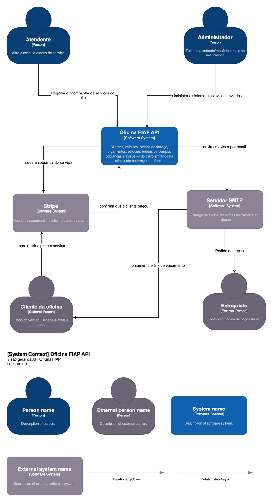
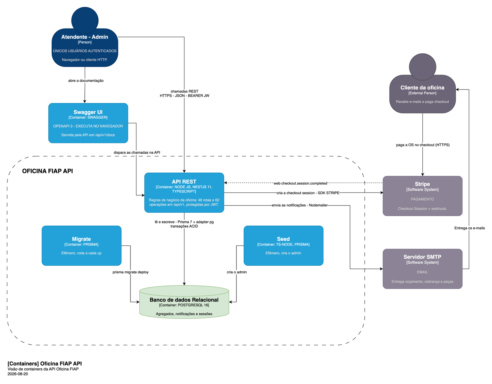
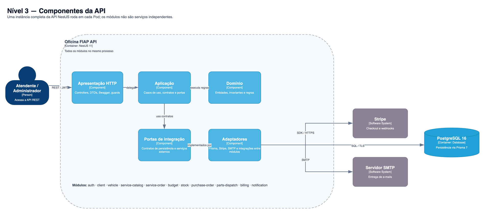
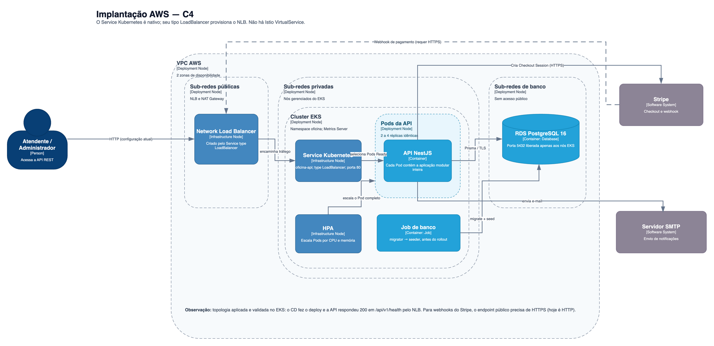
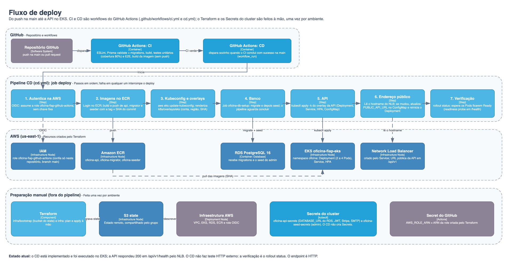

# Diagramas de arquitetura (C4)

Modelo C4 da Oficina FIAP API, níveis 1 a 3, mais a implantação na AWS e o
fluxo de deploy da Fase 2.

| # | Diagrama | Imagem | Fonte | Responde a pergunta |
|---|---|---|---|---|
| 1 | Contexto | `nivel-1-contexto.png` | página *Diagrama de contexto - OFICINA FIAP API* | Quem usa o sistema e com quais sistemas externos ele conversa |
| 2 | Containers | `nivel-2-containers.png` | página *Diagrama de containers - OFICINA API FIAP* | De quais peças executáveis o sistema é feito e como elas se falam (ambiente local, Docker Compose) |
| 3 | Componentes | `nivel-3-componentes.png` | página *Nível 3 - Componentes da API* | Como a API está organizada por dentro, na Clean Architecture |
| 4 | Implantação AWS | `implantacao-aws.png` | página *Implantação AWS - C4* | Onde cada peça roda na AWS: rede, EKS, banco e balanceador |
| 5 | Fluxo de deploy | `fluxo-de-deploy.png` | página *Fluxo de deploy* | Como o código chega do push até a API no EKS |

As imagens são exportações do `c4-diagram-oficina-fiap.drawio`, que é a fonte:
um XML sem compactação, versionável e diffável. Para editar, abra em
[app.diagrams.net](https://app.diagrams.net) ou no draw.io desktop — as cinco
páginas aparecem como abas na parte de baixo. **Ao alterar o diagrama, reexporte
as imagens**, senão elas passam a contar uma história diferente da fonte.

## Nível 1 — Contexto

Os atores autenticados são o **Atendente** (perfil `EMPLOYEE`) e o
**Administrador** (perfil `ADMIN`). O **Cliente da oficina** e o **Estoquista**
são pessoas externas: o estoquista só recebe e-mail, e o cliente recebe e-mail
e paga pelo checkout do Stripe. Os sistemas externos são o **Stripe** e o
**Servidor SMTP**.

## Nível 2 — Containers

Os quatro serviços do `docker-compose.yml` aparecem como containers: **API REST**
(NestJS), **Migrate** e **Seed** (efêmeros, rodam a cada `up`) e o banco
**PostgreSQL**. A **Swagger UI** é servida pela própria API em `/api/v1/docs`.
Este nível retrata o ambiente local; a nuvem está nos diagramas 4 e 5.

## Nível 3 — Componentes

Uma instância completa da API roda em cada Pod; os módulos não são serviços
independentes. Cada módulo de `src/modules` segue as mesmas camadas, com a
dependência apontando para dentro: a **apresentação HTTP** delega à **aplicação**
(casos de uso, contratos e portas), que executa regras do **domínio**; os
**adaptadores** implementam as portas e falam com Prisma, Stripe, SMTP e com
outros módulos. O guia da migração está em
[../wiki/migracao-clean-architecture.md](../wiki/migracao-clean-architecture.md).

## Implantação AWS

A VPC tem duas zonas de disponibilidade e três tipos de sub-rede. O **Network
Load Balancer** e o NAT Gateway ficam nas públicas; os nós do **EKS**, com a
API em 2 a 4 réplicas controladas pelo HPA, ficam nas privadas; o **RDS
PostgreSQL** fica nas de banco, sem acesso público e com a porta 5432 liberada só
para os nós. O Job de banco roda a migration e o seed antes do rollout. O
Service do tipo LoadBalancer é quem provisiona o NLB. O endpoint é HTTP, então o
webhook do Stripe exigiria HTTPS. Detalhes da infraestrutura em
[../wiki/infraestrutura-terraform.md](../wiki/infraestrutura-terraform.md) e
[../wiki/kubernetes.md](../wiki/kubernetes.md).

## Fluxo de deploy

O `ci.yml` valida o código (lint, Prisma, build, testes unitários e E2E, build da
imagem). Quando ele conclui com sucesso na `main`, o `cd.yml` dispara sozinho:
autentica na AWS por OIDC, publica as três imagens (api, migrator e seeder) no
ECR com o SHA do commit como tag, ajusta os overlays do Kubernetes, roda o Job
`oficina-db-setup`, aplica a API e aguarda o rollout. O Terraform e os Secrets do
cluster ficam fora do pipeline e são feitos uma vez por ambiente.
